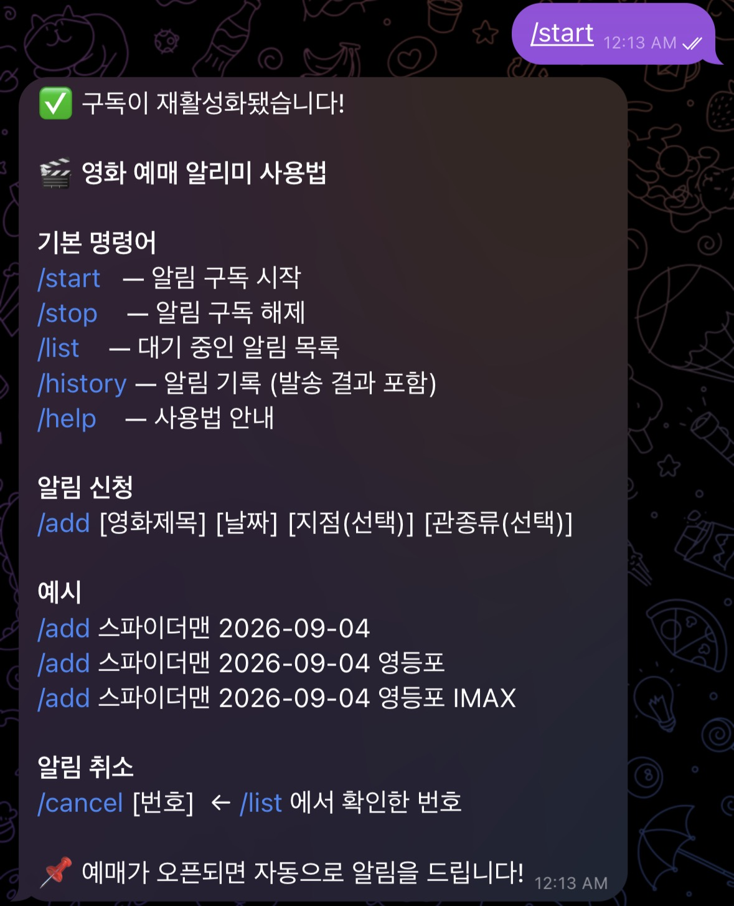
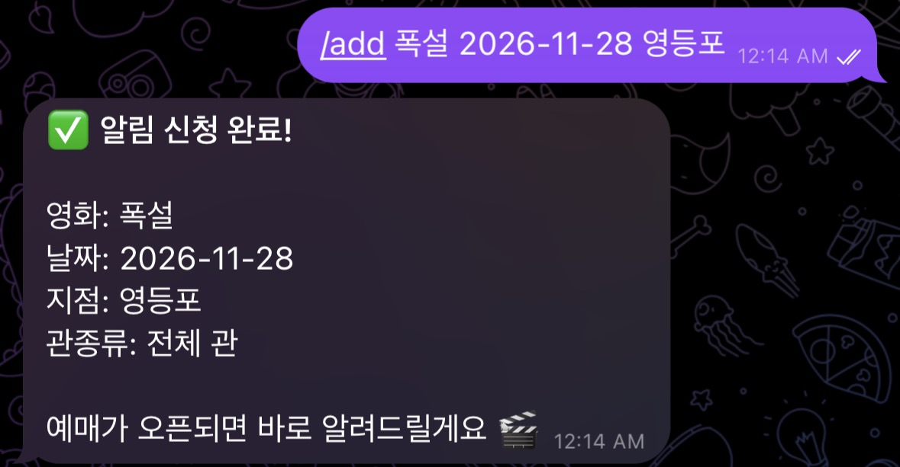
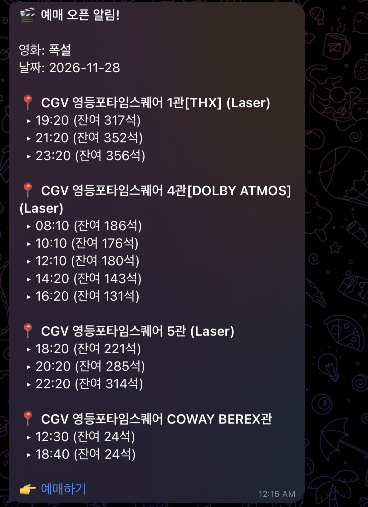
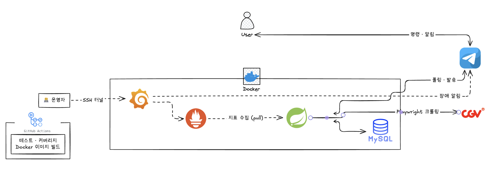
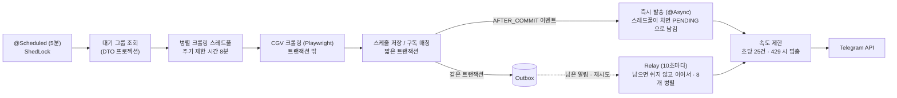

# 🎬 영화 예매 오픈 알리미 (Movie Bot)

[](https://github.com/CHUNYOUNGSANG/movie/actions/workflows/ci.yml)

CGV 상영 일정을 주기적으로 크롤링해서, 신청한 조건(영화 / 지점 / 상영관 / 날짜)의 **예매가 열리면 텔레그램으로 바로 알려주는 봇**입니다.

## 프로젝트 소개

인기 영화의 특별관(IMAX 등) 예매는 언제 열릴지 몰라 계속 새로고침해야 합니다. 텔레그램으로 영화·지점·상영관·날짜를 신청해 두면, 봇이 5분마다 CGV 상영 일정을 확인해 **예매가 열리는 순간 알림**을 보냅니다.

| 항목 | 내용 |
|---|---|
| 기간 | 2026.09 ~ 2026.11 (약 12주) |
| 인원 | 개인 프로젝트 (기획 · 설계 · 구현 · 테스트 · 배포) |
| 핵심 | 알림 유실·중복 없는 발송 (Transactional Outbox), 다중 서버 동시성, 텔레그램 속도 제한 대응 |
| 품질 | 테스트 219건, 커버리지 라인 93.1% / 분기 83.0%, 패키지 의존 규칙 ArchUnit 고정 |

## 주요 기능 · 사용법

텔레그램 봇에 명령어를 보내 사용합니다.

| 명령어 | 설명 |
|---|---|
| `/start` | 알림 구독 시작 |
| `/add [영화] [날짜] [지점] [관]` | 알림 신청. 지점·관은 선택, 제목에 띄어쓰기 가능 |
| `/list` | 대기 중인 알림 목록 |
| `/history` | 완료된 알림 목록 |
| `/cancel [번호]` | 알림 취소 |
| `/stop` | 구독 해제 |
| `/help` | 사용법 안내 |

**사용 예시**

<table>
  <tr>
    <th>1. 구독 시작 (/start)</th>
    <th>2. 알림 신청 (/add)</th>
    <th>3. 예매 오픈 알림</th>
  </tr>
  <tr>
    <td></td>
    <td></td>
    <td></td>
  </tr>
</table>

- 날짜는 `YYYY-MM-DD`. 날짜 앞까지가 영화 제목입니다.
- **지원 지점: CGV 서울 8곳** (영등포, 용산, 강남, 홍대, 신촌, 왕십리, 건대입구, 여의도). 지점을 빼거나 목록에 없는 지점을 쓰면 8곳 전체를 확인합니다.
- 관(IMAX, 4DX 등)을 빼면 모든 관을 확인합니다. 상영일이 지나면 신청은 자동으로 만료되고 안내가 갑니다.
- 웹 확장용 REST API 도 있습니다: `POST /api/auth/telegram`(텔레그램 로그인 서명 검증 → JWT 발급), `POST · GET · DELETE /api/notifications`(JWT 필요, 내 신청만 조회·취소).

## 기술 스택

| 분야 | 기술 |
|---|---|
| Backend |     |
| Database |  |
| Security |  |
| Crawling |  |
| Messaging |  |
| Concurrency |  |
| Infra / CI |   |
| Monitoring |   |
| Test |     |

## 시스템 아키텍처



| 구성 | 역할 |
|---|---|
| 사용자 ↔ Telegram | 사용자는 텔레그램 봇으로 명령(`/add` 등)을 보내고 알림을 받습니다. 별도 웹 화면은 없습니다 |
| Spring Boot 앱 | 3초마다 텔레그램에서 명령을 가져오고(폴링), 5분마다 CGV 를 크롤링해 예매가 열린 신청을 찾아 알림을 보냅니다 |
| CGV | Cloudflare 확인을 통과한 브라우저 세션이 있어야 조회돼, Playwright(헤드리스 Chromium)로 크롤링합니다 |
| MySQL | 신청·상영 일정·보낼 알림(Outbox)을 저장합니다. 매칭과 Outbox 기록을 한 트랜잭션으로 묶어 알림이 사라지거나 두 번 가지 않게 합니다 |
| Prometheus | 15초마다 앱의 지표(`/actuator/prometheus`)를 가져와 30일 보관합니다 |
| Grafana | 대시보드로 발송·크롤링·DB 상태를 보여 주고, 앱 다운·발송 지연 같은 장애를 텔레그램으로 알립니다 |
| 운영자 | 모니터링 포트는 서버 안(`127.0.0.1`)에만 열려 있어 SSH 터널로 Grafana 에 접속합니다 |
| GitHub Actions | PR 마다 테스트·커버리지 요약·Docker 이미지 빌드를 확인합니다 |

- 앱, MySQL, Prometheus, Grafana 는 서버 한 대에서 Docker Compose 로 함께 뜹니다.
- 실선은 서비스 흐름, 점선은 모니터링 흐름입니다.

## 동작 흐름



## 프로젝트 구조

```txt
src/main/java/io/github/chunyoungsang/moviebot
├── domain/                    # 비즈니스 로직. 외부 기술을 모르고 포트(인터페이스)만 정의
│   ├── movie/                 # 영화·지점·상영관·상영 일정, crawler/MovieCrawler (포트)
│   ├── notification/          # 알림 신청·매칭·이력, 보관 정책, 스케줄러
│   │   ├── outbox/            # Transactional Outbox: 기록 · 즉시 발송 · relay · 재시도 · 지표
│   │   └── sender/            # MessageSender (발송 포트)
│   └── user/                  # 텔레그램 chatId 기준 사용자
├── infra/                     # 외부 연동. domain 의 포트를 구현
│   ├── cgv/                   # CgvCrawler (Playwright)
│   ├── telegram/              # 클라이언트(속도 제한·429), 봇 명령어, 로그인 서명 검증
│   └── loadtest/              # 부하 테스트 전용 가짜 크롤러 (loadtest 프로필)
└── global/                    # 공통 설정(스레드풀·시계), 예외 처리, 보안(JWT)

src/main/resources/db/migration   # Flyway 마이그레이션 (V1 ~ V6)
monitoring/                       # Prometheus 수집 설정, Grafana 대시보드·알림 규칙
loadtest/                         # 부하 테스트: 가짜 텔레그램 서버, 시드 데이터, 측정 스크립트
```

- 의존 방향은 `infra → domain`, `global` 은 둘 다 모릅니다. `architecture/ArchitectureTest`(ArchUnit) 가 검사합니다.

## 핵심 개선

기능을 만든 뒤 운영에서 깨질 지점을 찾아, 매번 **문제를 재현하는 테스트를 먼저** 쓰고 고친 뒤 전후를 쟀습니다.

- **알림 유실·중복 방지**: 크롤링을 트랜잭션 밖으로 빼고 Transactional Outbox 도입 → 중복 발송 2 → 1회, 발송 실패 시 영구 유실 → 재시도
- **다중 서버 동시성**: 조건부 UPDATE 선점 + ShedLock → 중복 알림·MySQL 데드락 제거
- **대량 데이터 조회**: 그룹만 DTO 로 조회 + 실행 계획으로 옵티마이저 추정 오류 해결 → 주기 152 → 32ms
- **배포 안정성**: 종료 시 멈추던 크롤링 주기 수정, non-root Docker 이미지 → 종료 대기 15초+ → 10ms
- **발송 처리량**: 부하 테스트 지표로 relay 병목 발견 → 알림 5,000건 전체 발송 1,265 → 236초

> 수치는 Testcontainers MySQL 8.4 통합 테스트와 로컬 부하 테스트([loadtest/](loadtest/README.md))로 잰 값입니다. 운영 부하 수치가 아닙니다.

## 한계

- 지원 지점이 코드에 고정된 8곳입니다. 지점을 늘리려면 CGV 지점 번호를 추가해야 합니다.
- CGV 화면·API 구조가 바뀌면 크롤러를 고쳐야 합니다. 바뀐 걸 바로 알 수 있게 크롤링 실패를 지표로 모으고 Grafana 알림을 걸어 두었습니다.
- 발송 속도 제한(초당 25건)이 서버 메모리에 있습니다. 서버가 여러 대면 합산 속도가 텔레그램 한도를 넘을 수 있어, 공유 속도 제한(예: Redis)이 필요합니다.
- 봇 하나의 텔레그램 한도(초당 약 30건) 때문에 알림이 수만 건 몰리면 발송에 수십 분이 걸립니다.

## 설정 및 실행

### 1. 필요한 것

- Docker (Docker Desktop 또는 OrbStack)
- 로컬에서 직접 실행·테스트하려면 Java 17

### 2. 텔레그램 봇 만들기

1. 텔레그램에서 [@BotFather](https://t.me/BotFather) 에게 `/newbot` → 이름 입력 → **봇 토큰** 발급
2. 내 chat id 확인: [@userinfobot](https://t.me/userinfobot) 에게 아무 메시지나 보내면 `Id` 가 나옵니다 (Grafana 장애 알림을 받을 곳)

### 3. `.env` 설정

```bash
cp .env.example .env
```

| 변수 | 필수 | 설명 |
|---|---|---|
| `TELEGRAM_BOT_TOKEN` | ✅ | BotFather 에서 받은 봇 토큰 |
| `DB_ROOT_PASSWORD`, `DB_USER`, `DB_PASSWORD` | ✅ | MySQL 계정 (처음 뜰 때 이 값으로 만들어짐) |
| `GRAFANA_ADMIN_PASSWORD` | ✅ | Grafana 관리자 비밀번호 (예: `openssl rand -base64 18`) |
| `GRAFANA_ALERT_TELEGRAM_CHAT_ID` | ✅ | 장애 알림을 받을 내 chat id |
| `GRAFANA_ADMIN_USER` | | Grafana 관리자 아이디 (기본 `admin`) |
| `AUTH_JWT_SECRET` | | REST API 토큰 서명 키, 32자 이상. 비우면 재시작마다 새로 만들어짐 |
| `MOVIE_CHECK_CRON` | | CGV 확인 주기 (기본 5분: `0 */5 * * * *`) |

`.env` 에는 토큰·비밀번호가 들어가므로 커밋하지 않습니다 (`.gitignore` 에 포함).

### 4. 실행

```bash
docker compose up -d --build    # 앱 + MySQL + Prometheus + Grafana
docker compose ps               # app·db 가 (healthy) 이면 정상
docker compose logs -f app      # 로그 보기
```

봇에게 `/start` 를 보내 응답이 오면 준비 완료입니다.

| 화면 | 주소 |
|---|---|
| Grafana ("Moviebot 운영" 대시보드) | http://localhost:3000 (`.env` 의 Grafana 계정) |
| Prometheus | http://localhost:9090 |

Prometheus·Grafana 는 `127.0.0.1` 에만 열립니다. 서버에 배포했다면 SSH 터널로 접속합니다: `ssh -L 3000:localhost:3000 사용자@서버`

### 5. 종료

```bash
docker compose down             # 컨테이너 종료 (데이터는 볼륨에 남음)
docker compose down -v          # 데이터까지 삭제
```

### 개발용: 로컬 실행 · 테스트

Docker 가 켜져 있으면 MySQL 8.4 컨테이너가 자동으로 뜨고 종료 시 정리됩니다 (Testcontainers). `bootTestRun` 은 `.env` 의 봇 토큰을 읽습니다.

```bash
./gradlew bootTestRun           # 앱 실행
./gradlew test                  # 전체 테스트 (실제 텔레그램·CGV 는 호출하지 않음)
```
