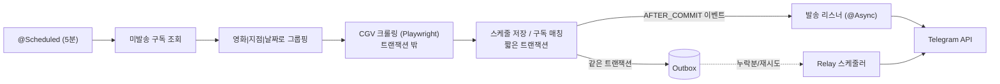

# 🎬 영화 예매 오픈 알리미 (Movie Bot)

[](https://github.com/CHUNYOUNGSANG/movie/actions/workflows/ci.yml)

CGV 상영 일정을 주기적으로 크롤링해서, 신청한 조건(영화 / 지점 / 상영관 / 날짜)의 **예매가 열리면 텔레그램으로 바로 알려주는 봇**입니다.

## 주요 기능

텔레그램 봇에 명령어를 보내 사용합니다.

| 명령어 | 설명 |
|---|---|
| `/start` | 알림 구독 시작 |
| `/add [영화] [날짜] [지점] [관]` | 알림 신청 (지점, 관은 선택). 예: `/add 위키드 2026-12-24 영등포 IMAX` |
| `/list` | 대기 중인 알림 목록 |
| `/history` | 완료된 알림 목록 |
| `/cancel [번호]` | 알림 취소 |
| `/stop` | 구독 해제 |

## 기술 스택

- **Backend**: Java 17, Spring Boot 4.1, Spring Data JPA, Flyway
- **DB**: MySQL 8.4 (운영 / 로컬·테스트는 Testcontainers)
- **Crawling**: Playwright (Chromium)
- **Messaging**: Telegram Bot API
- **Infra**: Docker, Docker Compose
- **Monitoring**: Spring Boot Actuator, Micrometer (Prometheus)

## 동작 흐름



## 주요 개선 사항

### 알림 유실·중복 방지와 트랜잭션 범위 분리

크롤링(외부 I/O)과 발송이 하나의 긴 트랜잭션에 묶여 있던 구조를 통합 테스트로 재현한 뒤 개선했습니다.

| 시나리오 | Before | After |
|---|---|---|
| 크롤링 중 점유 중인 DB 커넥션 | 1개 | **0개** |
| 처리 도중 예외 → 다음 주기 | 같은 알림 2회 발송 | **1회** |
| 매칭 트랜잭션 롤백 | 롤백됐는데 발송됨 | **발송 안 됨** |
| 텔레그램 발송 실패 | SUCCESS 기록, 영구 유실 | **FAIL 기록 후 재시도** |

- Playwright 크롤링을 트랜잭션 밖으로 분리하고 DB 작업만 짧은 트랜잭션으로 처리
- `@TransactionalEventListener(AFTER_COMMIT)`으로 커밋된 경우에만 발송
- 발송 결과(SUCCESS / FAIL)를 기록하고, 실패하면 다음 주기에 재시도

👉 상세 정리 (문제 → 원인 → 해결 → 결과, 트러블슈팅): 노션 링크 추가 예정

### Transactional Outbox와 재시도 정책

이벤트만으로는 커밋 직후 서버가 죽으면 알림이 사라지고, 실패 시 무한 재시도하던 문제를 개선했습니다.

| 시나리오 (스케줄러 5주기) | Before | After |
|---|---|---|
| 커밋 직후 발송 리스너 유실 | 영구 유실 | **relay 가 발송** |
| 텔레그램 일시 장애(5xx) 지속 | 5회 (무한) | **최대 횟수 후 중단** |
| 사용자가 봇 차단(403) | 5회 (무한) | **1회 후 중단** |

- 구독 상태 변경과 보낼 메시지를 같은 트랜잭션으로 `notification_outbox`에 기록
- 커밋 후 리스너가 즉시 발송하고, 누락분/재시도는 relay 스케줄러가 처리 (조건부 UPDATE 로 중복 발송 방지)
- 재시도: 지수 백오프(30초 → 1분 → 2분 …), 최대 5회, 4xx(429 제외)는 영구 실패로 즉시 중단

👉 상세 정리: 노션 링크 추가 예정

### 크롤링 결과 저장 벌크 처리

결과 1건마다 영화/극장/상영관/스케줄을 조회하고 저장하던 구조를 개선했습니다. (실제 JDBC 실행 횟수 측정)

| 크롤링 결과 100건 저장 | Before | After |
|---|---|---|
| 신규 저장 | 514회 | **8회** |
| 갱신 (예매 오픈 여부 변경) | 500회 | **4회** |
| MySQL 8.4 실행 시간 (500건, 신규) | 366.4 ms | **20.9 ms** |
| MySQL 8.4 실행 시간 (500건, 갱신) | 318.6 ms | **20.8 ms** |

- 영화/극장/상영관은 중복 제거 후 IN 조회 1회씩, 없는 것만 생성 (`persist`로 merge 의 사전 SELECT 제거)
- 스케줄은 IDENTITY PK 라 Hibernate 배치가 불가해 `JdbcTemplate.batchUpdate` + `ON DUPLICATE KEY UPDATE` 로 upsert
- `hibernate.jdbc.batch_size`, MySQL `rewriteBatchedStatements=true` 설정

👉 상세 정리: 노션 링크 추가 예정

### 다중 서버 동시 실행 방지 (조건부 UPDATE + ShedLock)

서버를 2대 이상 띄웠을 때의 동시 실행 문제를 서버 2대를 흉내 낸 통합 테스트로 재현한 뒤 개선했습니다. (H2, MySQL 8.4 에서 수정 전/후 실행)

| 시나리오 (서버 2대 동시 실행) | Before | After |
|---|---|---|
| 같은 구독 동시 매칭 (H2) | 알림 2건 (중복 발송) | **1건** |
| 같은 구독 동시 매칭 (MySQL 8.4) | 데드락 → 매칭 트랜잭션 롤백 | **1건, 데드락 없음** |
| 크롤링 스케줄러 동시 실행 | 크롤링 2회 | **1회** |

- 읽은 값(`triggered`)으로 판단하던 것을 조건부 UPDATE 의 영향 행 수로 선점하도록 변경 (X 락을 먼저 잡아 외래키 S 락 → X 락 데드락도 제거)
- 크롤링·텔레그램 폴링은 ShedLock(DB 시간 기준)으로 한 서버에서만 실행, 폴링 offset 은 DB 로 옮겨 서버 간 공유
- Outbox relay 는 건별 선점이 있어 락 없이 여러 서버가 나눠 처리

👉 상세 정리: 노션 링크 추가 예정

### 텔레그램 발송 속도 제한 대응

알림이 몰릴 때 텔레그램 속도 제한(429)으로 정상 알림이 발송을 포기하던 문제를, 초당 30건을 넘으면 429 를 주는 가짜 텔레그램으로 재현한 뒤 개선했습니다.

| 알림 100건 동시 발송 | Before | After |
|---|---|---|
| 발송 포기 (DEAD) | 70건 | **0건** |
| 429 응답 | 350회 | **0회** |
| 발송 완료 | 30건 | **100건 (4.2초)** |

- 429 는 메시지 실패가 아니므로 시도 횟수를 쓰지 않고 응답의 `retry_after` 뒤로 미룸
- 재시도만으로는 밀린 건이 한꺼번에 몰려 429 가 오히려 늘어(350 → 933회), 발송 전 속도 제한(40ms 간격, 초당 25건) 추가
- 429 를 받으면 `retry_after` 동안 모든 스레드의 발송을 멈춤 (flood control 중 추가 요청은 제한 시간을 늘림)

👉 상세 정리: 노션 링크 추가 예정

### 크롤링 병렬화

그룹(영화|지점|날짜)마다 순서대로 크롤링하던 구조를, 크롤링 지연을 흉내 낸 가짜 크롤러로 재현한 뒤 개선했습니다.

| 측정 | Before | After |
|---|---|---|
| 그룹 10개, 크롤링 1회 500ms (통합 테스트) | 5.58초 | **2.09초** |
| 실제 Playwright, 요청 9건 × 500ms (로컬 HTTP 서버) | 4.66초 | **1.57초** |

- 크롤링(외부 I/O)만 전용 스레드풀(기본 3)에서 동시에 실행하고, DB 저장·매칭은 끝난 순서대로 순차 처리 (유니크 키 충돌 방지)
- Playwright 는 만든 스레드에서만 쓸 수 있어 `synchronized` 로 직렬화되던 크롤러를 스레드별 브라우저 세션으로 변경
- 한 그룹의 크롤링 실패가 다른 그룹 처리를 막지 않도록 격리

👉 상세 정리: 노션 링크 추가 예정

### 모니터링 (헬스 체크 + 알림·크롤링 지표)

알림이 발송 포기(DEAD)로 쌓여도 WARN 로그 말고는 알 방법이 없던 상황을, 봇 차단(403) 3건으로 통합 테스트에서 재현한 뒤 개선했습니다.

| 항목 | Before | After |
|---|---|---|
| 헬스 체크 `/actuator/health` | 404 | **200 UP** |
| DEAD 3건을 알 수 있는 신호 | WARN 로그뿐 | **지표 3종** (적체 수 · 발송 결과 · 크롤링) |

- 알림 적체(상태별 건수, 가장 오래된 대기 시간), 발송 결과(성공·재시도·속도 제한·포기), 크롤링·확인 주기 소요 시간을 Prometheus 지표로 노출
- 적체 지표는 읽을 때마다 DB 를 조회하지 않고 30초마다 한 번 집계해 수집 횟수와 무관하게 DB 부하 일정
- 관리용 엔드포인트는 서비스 포트와 분리된 8081 에서만 열고 외부에 공개하지 않음

👉 상세 정리: 노션 링크 추가 예정

### 크롤러 오류 감지 ("상영 없음"과 "조회 실패" 구분)

크롤러가 실패해도 빈 결과를 돌려줘 Cloudflare 차단·브라우저 실행 실패가 "상영 없음"과 구분되지 않던 문제를, 가짜 Playwright 세션으로 CGV 응답(403, 502)을 흉내 내 재현한 뒤 개선했습니다.

| 상황 | Before | After |
|---|---|---|
| 브라우저 실행 실패 / Cloudflare 차단(403) / 모든 극장 API 502 | 빈 결과 0건 (상영 없음과 동일) | **실패로 알림 + 단계·원인별 지표** |
| 극장 8곳 중 3곳만 502 | 5곳 결과만, 실패는 조용히 누락 | 결과 5건 + **오류 지표 3** |

- 크롤러 규칙을 "실패해도 빈 리스트"에서 "상영 없음 → 빈 결과, 조회 실패 → `CrawlException`"으로 변경 (병렬화 이후 그룹 단위로 실패가 격리되어 예외를 삼킬 이유가 사라짐)
- 일부 극장만 실패하면 나머지 결과는 살리고, `crawl.errors{stage, reason}` 지표로 실패를 기록
- 브라우저가 없는 CI 에서도 돌도록 세션 생성을 주입 가능하게 바꾸고 Playwright 인터페이스를 Mockito 로 흉내 내 테스트

👉 상세 정리: 노션 링크 추가 예정

### 패키지 구조 정리 (domain / infra / global + SOLID 점검 + 예외 체계)

패키지 의존 규칙을 ArchUnit 테스트로 먼저 고정해 위반 건수를 잰 뒤, 구조를 옮기고 SOLID 위반을 고쳤습니다.

| 항목 | Before | After |
|---|---|---|
| 도메인 간 순환 / 업무 도메인 → telegram / global → 도메인 의존 | 1 / 11 / 3건 | **0 / 0 / 0건** (규칙 6개로 고정) |
| 봇 명령어 추가 시 수정할 곳 | 2곳 (if/else + 메뉴 목록) | **새 클래스 1개** |
| 예상하지 못한 오류의 API 응답 | 400 + 내부 메시지 노출 | **500 + 공통 메시지** |

- 비즈니스 도메인(`domain`)과 외부 연동(`infra`: 텔레그램, CGV 크롤러)을 나누고, 포트(`MessageSender`, `MovieCrawler`)는 쓰는 쪽인 도메인에 둠 (DIP)
- 275줄 봇 클래스를 명령어별 클래스로 나누고, 신청 관리와 예매 확인 서비스를 분리 (SRP, OCP, ISP)
- 비즈니스 오류를 JDK 예외 대신 `BusinessException` + 도메인별 `ErrorCode` 로 바꿔 `{code, message}` 형식으로 통일

👉 상세 정리: 노션 링크 추가 예정

### Outbox 역할 분리 (하위 패키지 + 재시도 정책 + 상태 전이 + 공개용 상태)

기능을 붙일 때마다 한 패키지에 쌓인 Outbox 를 책임과 경계로 나누고, 경계는 ArchUnit 으로 고정했습니다.

| 항목 | Before | After |
|---|---|---|
| outbox 패키지 구성 | 1개 패키지에 역할 6가지 + 즉시 발송만 다른 패키지 | **역할별 하위 패키지 6개**, 밖에서는 `service` 만 사용 |
| 봇이 아는 Outbox 상태 | 내부 상태 4가지 + "Outbox 없으면 완료" 규칙 | **`DeliveryStatus` 3가지** |
| Outbox 쿼리 실제 DB 검증 | 멈춘 발송 복구·재시도 대상 조회는 없음 | **5개 쿼리 모두** (전체 테스트 129 → 150건) |

- 재시도 판단(429, 영구 실패, 최대 횟수, 백오프)을 DB 와 무관한 `RetryPolicy` 로 분리해 mock 없이 테스트
- 상태 변경은 엔티티 메서드로만 (setter 제거, 끝난 상태 SENT·DEAD 는 변경 불가), 기록과 즉시 발송 이벤트 발행은 `enqueue` 하나로
- 리팩터링 중 드러난 불안정한 테스트(커넥션 점유 측정이 백그라운드 relay 와 겹침)를 원인부터 고침

👉 상세 정리: 노션 링크 추가 예정

### API 인증 (텔레그램 로그인 서명 검증 + JWT + 본인 데이터만)

봇과 달리 텔레그램을 거치지 않는 REST API 가 누구나 모든 사용자의 정보를 보고 남의 chatId 로 알림을 조작할 수 있던 문제를 막았습니다.

| 상황 (재현 테스트) | Before | After |
|---|---|---|
| 토큰 없이 전체 조회 | 200, 다른 사용자 chatId 노출 | **401**, 노출 0 |
| 토큰 없이 남의 알림 취소 / 신청 | 성공 (삭제됨 / 1건 등록) | **401**, 변화 없음 |
| 로그인한 사용자가 남의 알림 취소 | 204, 삭제됨 | **403**, 그대로 |
| 위조 서명 / 만료된 로그인 정보 | — | **401** |

- `POST /api/auth/telegram`: 텔레그램 로그인 위젯 정보를 HMAC-SHA256(SHA256(봇 토큰)) 으로 검증(상수 시간 비교, 24시간 만료) 후 JWT 발급
- `/api/notifications` 는 Bearer 토큰 필수, 사용자는 요청의 chatId 대신 토큰에서 가져옴 (Spring Security + OAuth2 Resource Server)
- 응답을 엔티티 대신 DTO 로 바꿔 chatId 등 내부 정보 제외, 401 도 같은 `{code, message}` 형식 (전체 테스트 150 → 170건)

👉 상세 정리: 노션 링크 추가 예정

### 비활성 사용자 알림 (구독 해제·봇 차단 사용자에게 알림이 가지 않게)

`/stop` 이 플래그만 바꾸고 아무도 확인하지 않아, 구독을 해제한 사용자에게도 알림이 가던 문제를 고쳤습니다.

| 상황 (재현 테스트) | Before | After |
|---|---|---|
| `/stop` 한 사용자 | 크롤링 1회, 발송 1건 | **크롤링 0회, 발송 0건** |
| 재시도 대기 중 `/stop` | 재시도로 발송됨 | **보내지 않음** (Outbox `CANCELED`) |
| 봇 차단(403) | 사용자 활성 유지, 계속 크롤링 | **자동 구독 해제**, 크롤링 0회 |

- 크롤링 대상 조회 · 매칭 · 발송 직전(선점) 세 지점에서 구독 여부를 확인 (재시도 대기 중 바뀐 상태까지)
- 사용자의 선택으로 보내지 않은 알림은 실패(DEAD)가 아닌 `CANCELED` 로 끝내 실패 지표를 오염시키지 않음
- 텔레그램 403·400 chat not found 를 "받는 사람에게 보낼 수 없음"으로 분류해 자동 구독 해제 (전체 테스트 170 → 180건)

👉 상세 정리: 노션 링크 추가 예정

### 알림 신청 수명과 입력 검증 (지난 날짜 크롤링 중단 + 만료 안내 + 중복 방지)

끝이 없던 알림 신청에 만료를 두고, 신청 입구에서 잘못된 요청을 걸렀습니다.

| 상황 (재현 테스트) | Before | After |
|---|---|---|
| 상영일이 지난 신청 | 5분마다 계속 크롤링 | **크롤링 0회**, 매일 만료 + 안내 1회 |
| 지난 날짜 / 빈 제목 / 제목 없음 | 저장됨 / 저장됨 / **500** | **400** (`TARGET_DATE_PAST`, `INVALID_SUBSCRIPTION_REQUEST`) |
| 같은 조건 두 번 신청 | 둘 다 저장 | **409 `DUPLICATE_SUBSCRIPTION`** |

- "오늘"은 Asia/Seoul 로 고정한 `Clock` 하나로 (서버 TZ 와 무관, 테스트에서 날짜 경계 고정)
- 봇·API 공통 규칙이라 서비스에서 검증, 지점·상영관 "전체(null)" 끼리의 중복은 JPQL 로 명시해 실제 MySQL 로 검증
- 만료는 조건부 UPDATE 로 선점해 안내가 두 번 가지 않음, 고정 날짜 테스트를 상대 날짜로 바꿔 시한폭탄 제거 (전체 테스트 180 → 193건)

👉 상세 정리: 노션 링크 추가 예정

### 크롤링 주기의 대량 처리 (그룹만 조회 + 대기 신청 인덱스 + 주기 제한 시간)

매 주기 대기 신청 전체를 엔티티로 읽던 것을 그룹만 조회하도록 바꾸고, 주기 전체에 제한 시간을 뒀습니다.

| 항목 (재현 테스트) | Before | After |
|---|---|---|
| 평소 주기에 읽은 엔티티 (신청 5만, 대기 5천) | 6,050개 | **0개** (주기 152ms → 32ms) |
| 대기 신청 조회 실행 계획 | users 전체(ALL) → 사용자별 신청 | **신청 인덱스 범위 5,000행 → users(PK)** |
| 느린 주기 (그룹 10 × 300ms, 제한 1초) | 3,060ms, 끝까지 대기 | **1,015ms**, 남은 크롤링은 다음 주기 |

- 영화·지점·날짜 그룹을 DB 에서 DTO 프로젝션으로 조회하고, 예매가 열린 그룹만 신청을 읽어 매칭
- 인덱스를 추가해도 `users.active` 선택도를 10% 로 추정해 계획이 안 바뀜 → `EXPLAIN ANALYZE` 로 확인하고 `users.active` 인덱스로 실제 행 수 기반 계획을 쓰게 함
- 주기 제한 시간(8분, ShedLock 10분보다 짧게) 초과 시 시작 안 한 크롤링만 취소하고 `crawl.cycle.timeout` 지표로 남김 (전체 테스트 193 → 200건)

👉 상세 정리: 노션 링크 추가 예정

## 실행 방법

```bash
cp .env.example .env        # TELEGRAM_BOT_TOKEN 등 입력
docker compose up -d --build
```

로컬 실행 / 테스트 (Docker 필요, MySQL 8.4 컨테이너가 자동으로 뜨고 종료 시 정리됨):

```bash
./gradlew bootTestRun       # Testcontainers MySQL 로 앱 실행
./gradlew test              # 통합 테스트도 MySQL 8.4 컨테이너에서 실행
```

모니터링 엔드포인트 (관리용 포트 8081, docker compose 에서는 호스트에 공개하지 않음):

```bash
curl localhost:8081/actuator/health       # 로컬 실행 시
curl localhost:8081/actuator/prometheus   # 지표 (notification_*, crawl_*)
```
