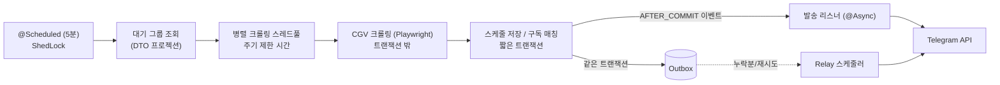

# 🎬 영화 예매 오픈 알리미 (Movie Bot)

[](https://github.com/CHUNYOUNGSANG/movie/actions/workflows/ci.yml)

CGV 상영 일정을 주기적으로 크롤링해서, 신청한 조건(영화 / 지점 / 상영관 / 날짜)의 **예매가 열리면 텔레그램으로 바로 알려주는 봇**입니다.

## 주요 기능

텔레그램 봇에 명령어를 보내 사용합니다.

| 명령어 | 설명 |
|---|---|
| `/start` | 알림 구독 시작 |
| `/add [영화] [날짜] [지점] [관]` | 알림 신청 (지점, 관은 선택). 예: `/add 위키드 2026-12-24 영등포 IMAX` |
| `/list` | 대기 중인 알림 목록 |
| `/history` | 완료된 알림 목록 |
| `/cancel [번호]` | 알림 취소 |
| `/stop` | 구독 해제 |

## 기술 스택

- **Backend**: Java 17, Spring Boot 4.1, Spring Data JPA, Flyway
- **DB**: MySQL 8.4 (운영 / 로컬·테스트는 Testcontainers)
- **Crawling**: Playwright (Chromium)
- **Messaging**: Telegram Bot API
- **Concurrency**: ShedLock (DB 기반 분산 락), 크롤링 전용 스레드풀
- **Security**: Spring Security, OAuth2 Resource Server (JWT), 텔레그램 로그인 서명 검증
- **Infra**: Docker (non-root, HEALTHCHECK), Docker Compose, GitHub Actions (테스트 + 커버리지 + 이미지 빌드)
- **Monitoring**: Spring Boot Actuator, Micrometer (Prometheus)
- **Test**: JUnit 5, Testcontainers (MySQL 8.4), ArchUnit, JaCoCo

## 동작 흐름



## 한눈에 보기

- 기능을 만든 뒤 **운영에서 깨질 지점 17가지를 찾아 고쳤습니다**: 알림 유실·중복, 다중 서버, 속도 제한, 대량 데이터, 종료와 배포.
- 매번 **문제를 재현하는 테스트를 먼저** 쓰고(수정 전 실패 확인), 고친 뒤 같은 테스트로 전후를 쟀습니다.
- 표의 수치는 Testcontainers MySQL 8.4 통합 테스트로 재현·측정한 값입니다. 17번만 로컬 부하 테스트(가짜 텔레그램·가짜 크롤러, [loadtest/](loadtest/README.md))로 잰 값입니다. 둘 다 운영 부하 수치가 아닙니다.
- 테스트 **219건**, 커버리지 **라인 93.1% / 분기 83.0%** (JaCoCo, CI 실행 요약에 표시). 패키지 의존 규칙은 ArchUnit 으로 고정했습니다.

## 대표 개선 4가지

### 1. 알림이 사라지거나 두 번 가지 않게: 트랜잭션 범위 분리 + Transactional Outbox

크롤링(외부 I/O)과 발송이 하나의 긴 트랜잭션에 묶여 있어, 발송 실패는 삼켜지고 롤백되면 같은 알림이 다시 나갔습니다.

| 시나리오 (재현 테스트) | Before | After |
|---|---|---|
| 크롤링 중 점유 중인 DB 커넥션 | 1개 | **0개** |
| 처리 도중 예외 → 다음 주기 | 같은 알림 2회 발송 | **1회** |
| 텔레그램 발송 실패 | SUCCESS 기록, 영구 유실 | **FAIL 기록 후 재시도** |
| 커밋 직후 발송 리스너 유실 | 영구 유실 | **relay 가 발송** |
| 사용자가 봇 차단(403) | 5주기 내내 재시도 | **1회 후 중단** |

- 크롤링을 트랜잭션 밖으로 빼고, 구독 상태 변경과 보낼 메시지를 같은 트랜잭션으로 `notification_outbox` 에 기록
- 커밋 후 즉시 발송, 누락분·재시도는 relay 가 처리 (조건부 UPDATE 선점, 지수 백오프, 4xx 는 영구 실패)
- 트러블슈팅: `NOT_SUPPORTED` 만으로는 커넥션이 반납되지 않았다. 직접 선언한 쿼리 메서드는 트랜잭션이 없어 `EntityManager` 가 커넥션을 붙잡았기 때문 (측정으로 발견)

### 2. 서버가 두 대일 때: 조건부 UPDATE 선점 + ShedLock

`@Scheduled` 는 JVM 하나 안에서만 겹치지 않습니다. 서버 2대를 스레드 2개로 흉내 내 재현했습니다.

| 시나리오 (서버 2대 동시 실행) | Before | After |
|---|---|---|
| 같은 구독 동시 매칭 (H2) | 알림 2건 (중복 발송) | **1건** |
| 같은 구독 동시 매칭 (MySQL 8.4) | 데드락 → 매칭 트랜잭션 롤백 | **1건, 데드락 없음** |
| 크롤링 스케줄러 동시 실행 | 크롤링 2회 | **1회** |

- 읽은 값으로 판단하던 것을 조건부 UPDATE 의 영향 행 수로 선점
- MySQL 데드락 원인: Hibernate 가 INSERT 를 먼저 flush → 외래키 검사로 부모 행에 S 락 → 둘 다 X 락으로 올리려다 교착. X 락을 먼저 잡아 해결
- 크롤링·폴링은 ShedLock(DB 시간 기준), 폴링 offset 은 DB 로 옮겨 서버 간 공유. 정확성은 락이 아니라 DB 조건으로 보장

### 3. 데이터가 쌓였을 때: 그룹만 조회 + 실행 계획으로 찾은 옵티마이저 추정 오류

매 주기 대기 신청 전체를 엔티티로 읽던 것을, 크롤링에 필요한 그룹만 DTO 로 조회하도록 바꿨습니다.

| 항목 (신청 5만, 대기 5천) | Before | After |
|---|---|---|
| 평소 주기에 읽은 엔티티 | 6,050개 | **0개** (주기 152ms → 32ms) |
| 대기 신청 조회 실행 계획 | users 전체(ALL) → 사용자별 신청 | **신청 인덱스 범위 5,000행 → users(PK)** |
| 느린 주기 (그룹 10 × 300ms, 제한 1초) | 3,060ms, 끝까지 대기 | **1,015ms**, 남은 크롤링은 다음 주기 |

- 인덱스를 추가해도 계획이 바뀌지 않았다. `EXPLAIN ANALYZE` 로 보니 옵티마이저가 인덱스 없는 `users.active` 의 선택도를 기본값 10% 로 추정 → `users.active` 인덱스로 실제 분포 기반 계획을 쓰게 함
- 주기 제한 시간(8분, ShedLock 10분보다 짧게), 쌓이던 테이블엔 보관 정책(1,000건 배치 삭제)

### 4. 재배포할 때: 종료하면 멈추던 주기, 시작되지 않던 Docker 이미지

graceful shutdown 을 넣으려고 재현해 보니 숨은 버그 두 개가 나왔습니다.

| 항목 | Before | After |
|---|---|---|
| 종료 신호 후 크롤링 주기 종료 (재현 테스트) | 15초 넘게 끝나지 않음, ShedLock 락 10분 잔존 | **10~15ms**, 새 크롤링 0회 |
| Docker 이미지로 앱 시작 | 실패 (`lombok.config` 누락) | **healthy**, `docker stop` 0.2초 |

- `ExecutorCompletionService` + 스레드풀 종료: 스레드풀이 바깥 `QueueingFuture` 를 취소하면, 실행되지 않은 안쪽 `FutureTask` 가 완료 큐에 들어가 `get()` 이 영원히 대기 → 종료 신호를 받으면 시작 안 한 크롤링을 취소하고 0.2초 안에 주기를 끝냄
- 트러블슈팅: `await-termination` 을 덧댔더니 Spring 6.1+ 가 일시 정지한 스레드를 40초씩 기다려 테스트가 1분 → 10분 이상. 스레드 덤프로 찾고 설정을 뺌
- non-root 실행, HEALTHCHECK, CI 에 커버리지와 이미지 빌드 추가

## 전체 개선 기록

| # | 주제 | 핵심 결과 (재현 테스트) |
|---|---|---|
| 1 | 알림 유실·중복 방지와 트랜잭션 범위 분리 | 크롤링 중 커넥션 점유 1 → 0, 중복 발송 2 → 1회 |
| 2 | Transactional Outbox 와 재시도 정책 | 커밋 직후 유실 → relay 발송, 무한 재시도 → 최대 횟수 |
| 3 | 크롤링 결과 저장 벌크 처리 | 100건 저장 쿼리 514 → 8회, 500건 366ms → 21ms |
| 4 | 다중 서버 동시 실행 (조건부 UPDATE + ShedLock) | 중복 2 → 1건, MySQL 데드락 제거 |
| 5 | 텔레그램 발송 속도 제한 대응 | 100건 동시 발송 시 포기 70 → 0건, 429 350 → 0회 |
| 6 | 크롤링 병렬화 (스레드별 브라우저 세션) | 그룹 10개 5.58 → 2.09초 |
| 7 | 모니터링 (헬스 체크 + 지표) | 발송 포기를 알 방법: WARN 로그뿐 → 지표 3종 |
| 8 | 크롤러 오류 감지 | 차단·브라우저 실패가 "상영 없음"과 구분 안 됨 → 예외 + 원인별 지표 |
| 9 | 패키지 구조 정리 (domain / infra / global, SOLID, 예외 체계) | 의존 규칙 위반 1 / 11 / 3 → 0 / 0 / 0건 |
| 10 | Outbox 역할 분리 | 패키지 1개에 역할 6가지 → 하위 패키지 6개, 경계 ArchUnit 고정 |
| 11 | API 인증 (텔레그램 로그인 서명 검증 + JWT) | 토큰 없이 남의 데이터 조회·취소 → 401 / 403 |
| 12 | 비활성 사용자 알림 | `/stop` 한 사용자에게 발송 1 → 0건, 봇 차단 시 자동 해제 |
| 13 | 알림 신청 수명과 입력 검증 | 지난 신청 5분마다 크롤링 → 0회, 잘못된 신청 저장·500 → 400, 중복 신청 → 409 |
| 14 | 크롤링 주기의 대량 처리 | 읽은 엔티티 6,050 → 0개, 주기 152 → 32ms |
| 15 | 데이터 보관 정책 | 약 1년치 schedules 21,000 → 1,000행 |
| 16 | 배포 안정성 (graceful shutdown, non-root, CI) | 종료 후 주기 15초+ 대기 → 10ms, 이미지 시작 실패 → healthy |
| 17 | Outbox relay 처리량 (부하 테스트 + Grafana) | 알림 5,000건 전체 발송 1,265 → 236초, 최대 지연 1,233 → 204초 (로컬 부하 테스트) |

## 실행 방법

```bash
cp .env.example .env        # TELEGRAM_BOT_TOKEN 등 입력
docker compose up -d --build
```

로컬 실행 / 테스트 (Docker 필요, MySQL 8.4 컨테이너가 자동으로 뜨고 종료 시 정리됨):

```bash
./gradlew bootTestRun       # Testcontainers MySQL 로 앱 실행
./gradlew test              # 통합 테스트도 MySQL 8.4 컨테이너에서 실행
```

모니터링 엔드포인트 (관리용 포트 8081, docker compose 에서는 호스트에 공개하지 않음):

```bash
curl localhost:8081/actuator/health       # 로컬 실행 시
curl localhost:8081/actuator/prometheus   # 지표 (notification_*, crawl_*)
```

`docker compose up -d` 로 Prometheus(`127.0.0.1:9090`)와 Grafana(`127.0.0.1:3000`, "Moviebot 운영" 대시보드)가 함께 뜹니다. Grafana 알림 규칙(앱 다운·발송 지연·발송 포기·크롤링 실패·주기 제한 시간 초과)은 `.env` 의 `GRAFANA_ALERT_TELEGRAM_CHAT_ID` 로 텔레그램 발송됩니다. 설정은 `monitoring/` 에 있습니다.
