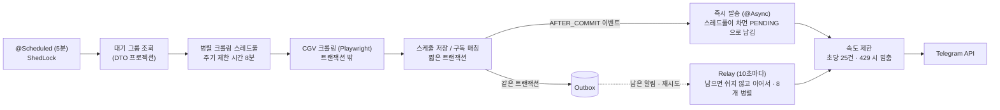

# 🎬 영화 예매 오픈 알리미 (Movie Bot)

[](https://github.com/CHUNYOUNGSANG/movie/actions/workflows/ci.yml)

CGV 상영 일정을 주기적으로 크롤링해서, 신청한 조건(영화 / 지점 / 상영관 / 날짜)의 **예매가 열리면 텔레그램으로 바로 알려주는 봇**입니다.

## 프로젝트 소개

인기 영화의 특별관(IMAX 등) 예매는 언제 열릴지 몰라 계속 새로고침해야 합니다. 텔레그램으로 영화·지점·상영관·날짜를 신청해 두면, 봇이 5분마다 CGV 상영 일정을 확인해 **예매가 열리는 순간 알림**을 보냅니다.

| 항목 | 내용 |
|---|---|
| 기간 | 2026.09 ~ 2026.11 (약 12주) |
| 인원 | 개인 프로젝트 (기획 · 설계 · 구현 · 테스트 · 배포) |
| 핵심 | 알림 유실·중복 없는 발송 (Transactional Outbox), 다중 서버 동시성, 텔레그램 속도 제한 대응 |
| 품질 | 테스트 219건, 커버리지 라인 93.1% / 분기 83.0%, 패키지 의존 규칙 ArchUnit 고정 |

## 주요 기능

텔레그램 봇에 명령어를 보내 사용합니다.

| 명령어 | 설명 |
|---|---|
| `/start` | 알림 구독 시작 |
| `/add [영화] [날짜] [지점] [관]` | 알림 신청 (지점, 관은 선택). 예: `/add 위키드 2026-12-24 영등포 IMAX` |
| `/list` | 대기 중인 알림 목록 |
| `/history` | 완료된 알림 목록 |
| `/cancel [번호]` | 알림 취소 |
| `/stop` | 구독 해제 |

## 기술 스택

| 분야 | 기술 |
|---|---|
| Backend |     |
| Database |  |
| Security |  |
| Crawling |  |
| Messaging |  |
| Concurrency |  |
| Infra / CI |   |
| Monitoring |   |
| Test |     |

## 시스템 아키텍처


| 구성 | 역할 |
|---|---|
| 사용자 ↔ Telegram | 사용자는 텔레그램 봇으로 명령(`/add` 등)을 보내고 알림을 받습니다. 별도 웹 화면은 없습니다 |
| Spring Boot 앱 | 3초마다 텔레그램에서 명령을 가져오고(폴링), 5분마다 CGV 를 크롤링해 예매가 열린 신청을 찾아 알림을 보냅니다 |
| CGV | Cloudflare 확인을 통과한 브라우저 세션이 있어야 조회돼, Playwright(헤드리스 Chromium)로 크롤링합니다 |
| MySQL | 신청·상영 일정·보낼 알림(Outbox)을 저장합니다. 매칭과 Outbox 기록을 한 트랜잭션으로 묶어 알림이 사라지거나 두 번 가지 않게 합니다 |
| Prometheus | 15초마다 앱의 지표(`/actuator/prometheus`)를 가져와 30일 보관합니다 |
| Grafana | 대시보드로 발송·크롤링·DB 상태를 보여 주고, 앱 다운·발송 지연 같은 장애를 텔레그램으로 알립니다 |
| 운영자 | 모니터링 포트는 서버 안(`127.0.0.1`)에만 열려 있어 SSH 터널로 Grafana 에 접속합니다 |
| GitHub Actions | PR 마다 테스트·커버리지 요약·Docker 이미지 빌드를 확인합니다 |

- 앱, MySQL, Prometheus, Grafana 는 서버 한 대에서 Docker Compose 로 함께 뜹니다.
- 실선은 서비스 흐름, 점선은 모니터링 흐름입니다.

## 동작 흐름



## 프로젝트 구조

```txt
src/main/java/io/github/chunyoungsang/moviebot
├── domain/                    # 비즈니스 로직. 외부 기술을 모르고 포트(인터페이스)만 정의
│   ├── movie/                 # 영화·지점·상영관·상영 일정, crawler/MovieCrawler (포트)
│   ├── notification/          # 알림 신청·매칭·이력, 보관 정책, 스케줄러
│   │   ├── outbox/            # Transactional Outbox: 기록 · 즉시 발송 · relay · 재시도 · 지표
│   │   └── sender/            # MessageSender (발송 포트)
│   └── user/                  # 텔레그램 chatId 기준 사용자
├── infra/                     # 외부 연동. domain 의 포트를 구현
│   ├── cgv/                   # CgvCrawler (Playwright)
│   ├── telegram/              # 클라이언트(속도 제한·429), 봇 명령어, 로그인 서명 검증
│   └── loadtest/              # 부하 테스트 전용 가짜 크롤러 (loadtest 프로필)
└── global/                    # 공통 설정(스레드풀·시계), 예외 처리, 보안(JWT)

src/main/resources/db/migration   # Flyway 마이그레이션 (V1 ~ V6)
monitoring/                       # Prometheus 수집 설정, Grafana 대시보드·알림 규칙
loadtest/                         # 부하 테스트: 가짜 텔레그램 서버, 시드 데이터, 측정 스크립트
```

- 의존 방향은 `infra → domain`, `global` 은 둘 다 모릅니다. `architecture/ArchitectureTest`(ArchUnit) 가 검사합니다.

## 개선 방식

- 기능을 만든 뒤 **운영에서 깨질 지점 17가지를 찾아 고쳤습니다**: 알림 유실·중복, 다중 서버, 속도 제한, 대량 데이터, 종료와 배포.
- 매번 **문제를 재현하는 테스트를 먼저** 쓰고(수정 전 실패 확인), 고친 뒤 같은 테스트로 전후를 쟀습니다.
- 아래 수치는 Testcontainers MySQL 8.4 통합 테스트로 재현·측정한 값입니다. 5번만 로컬 부하 테스트(가짜 텔레그램·가짜 크롤러)로 쟀습니다. 둘 다 운영 부하 수치가 아닙니다.

## 대표 개선 5가지

### 1. 알림이 사라지거나 두 번 가지 않게: 트랜잭션 범위 분리 + Transactional Outbox

크롤링(외부 I/O)과 발송이 하나의 긴 트랜잭션에 묶여 있어, 발송 실패는 삼켜지고 롤백되면 같은 알림이 다시 나갔습니다.

| 시나리오 (재현 테스트) | Before | After |
|---|---|---|
| 크롤링 중 점유 중인 DB 커넥션 | 1개 | **0개** |
| 처리 도중 예외 → 다음 주기 | 같은 알림 2회 발송 | **1회** |
| 텔레그램 발송 실패 | SUCCESS 기록, 영구 유실 | **FAIL 기록 후 재시도** |
| 커밋 직후 발송 리스너 유실 | 영구 유실 | **relay 가 발송** |
| 사용자가 봇 차단(403) | 5주기 내내 재시도 | **1회 후 중단** |

- 크롤링을 트랜잭션 밖으로 빼고, 구독 상태 변경과 보낼 메시지를 같은 트랜잭션으로 `notification_outbox` 에 기록
- 커밋 후 즉시 발송, 누락분·재시도는 relay 가 처리 (조건부 UPDATE 선점, 지수 백오프, 4xx 는 영구 실패)
- 트러블슈팅: `NOT_SUPPORTED` 만으로는 커넥션이 반납되지 않았다. 직접 선언한 쿼리 메서드는 트랜잭션이 없어 `EntityManager` 가 커넥션을 붙잡았기 때문 (측정으로 발견)

### 2. 서버가 두 대일 때: 조건부 UPDATE 선점 + ShedLock

`@Scheduled` 는 JVM 하나 안에서만 겹치지 않습니다. 서버 2대를 스레드 2개로 흉내 내 재현했습니다.

| 시나리오 (서버 2대 동시 실행) | Before | After |
|---|---|---|
| 같은 구독 동시 매칭 (H2) | 알림 2건 (중복 발송) | **1건** |
| 같은 구독 동시 매칭 (MySQL 8.4) | 데드락 → 매칭 트랜잭션 롤백 | **1건, 데드락 없음** |
| 크롤링 스케줄러 동시 실행 | 크롤링 2회 | **1회** |

- 읽은 값으로 판단하던 것을 조건부 UPDATE 의 영향 행 수로 선점
- MySQL 데드락 원인: Hibernate 가 INSERT 를 먼저 flush → 외래키 검사로 부모 행에 S 락 → 둘 다 X 락으로 올리려다 교착. X 락을 먼저 잡아 해결
- 크롤링·폴링은 ShedLock(DB 시간 기준), 폴링 offset 은 DB 로 옮겨 서버 간 공유. 정확성은 락이 아니라 DB 조건으로 보장

### 3. 데이터가 쌓였을 때: 그룹만 조회 + 실행 계획으로 찾은 옵티마이저 추정 오류

매 주기 대기 신청 전체를 엔티티로 읽던 것을, 크롤링에 필요한 그룹만 DTO 로 조회하도록 바꿨습니다.

| 항목 (신청 5만, 대기 5천) | Before | After |
|---|---|---|
| 평소 주기에 읽은 엔티티 | 6,050개 | **0개** (주기 152ms → 32ms) |
| 대기 신청 조회 실행 계획 | users 전체(ALL) → 사용자별 신청 | **신청 인덱스 범위 5,000행 → users(PK)** |
| 느린 주기 (그룹 10 × 300ms, 제한 1초) | 3,060ms, 끝까지 대기 | **1,015ms**, 남은 크롤링은 다음 주기 |

- 인덱스를 추가해도 계획이 바뀌지 않았다. `EXPLAIN ANALYZE` 로 보니 옵티마이저가 인덱스 없는 `users.active` 의 선택도를 기본값 10% 로 추정 → `users.active` 인덱스로 실제 분포 기반 계획을 쓰게 함
- 주기 제한 시간(8분, ShedLock 10분보다 짧게), 쌓이던 테이블엔 보관 정책(1,000건 배치 삭제)

### 4. 재배포할 때: 종료하면 멈추던 주기, 시작되지 않던 Docker 이미지

graceful shutdown 을 넣으려고 재현해 보니 숨은 버그 두 개가 나왔습니다.

| 항목 | Before | After |
|---|---|---|
| 종료 신호 후 크롤링 주기 종료 (재현 테스트) | 15초 넘게 끝나지 않음, ShedLock 락 10분 잔존 | **10~15ms**, 새 크롤링 0회 |
| Docker 이미지로 앱 시작 | 실패 (`lombok.config` 누락) | **healthy**, `docker stop` 0.2초 |

- `ExecutorCompletionService` + 스레드풀 종료: 스레드풀이 바깥 `QueueingFuture` 를 취소하면, 실행되지 않은 안쪽 `FutureTask` 가 완료 큐에 들어가 `get()` 이 영원히 대기 → 종료 신호를 받으면 시작 안 한 크롤링을 취소하고 0.2초 안에 주기를 끝냄
- 트러블슈팅: `await-termination` 을 덧댔더니 Spring 6.1+ 가 일시 정지한 스레드를 40초씩 기다려 테스트가 1분 → 10분 이상. 스레드 덤프로 찾고 설정을 뺌
- non-root 실행, HEALTHCHECK, CI 에 커버리지와 이미지 빌드 추가

### 5. 알림이 몰릴 때: 부하 테스트 지표로 찾은 relay 병목

가짜 텔레그램 서버(초당 30건 넘으면 429)와 가짜 크롤러로 알림 5,000건을 한꺼번에 만들고 Grafana 로 지켜봤습니다. 발송 속도가 1분 뒤 초당 25건에서 약 3건으로 떨어졌고, 429 는 0건이라 막힌 곳은 앱 안쪽이었습니다.

| 지표 (알림 5,000건, 로컬 부하 테스트) | Before | After |
|---|---|---|
| 전체 발송 시간 | 1,265초 (약 21분) | **236초** (이론상 최선 200초) |
| 초당 발송 | 4.0건 | **21.2건** |
| 알림 지연 p95 | 1,158초 | **195초** |
| 알림 지연 최대 | 1,233초 | **204초** |
| 429 / 발송 포기 | 0 / 0 | 0 / 0 |

- 원인: 즉시 발송 스레드풀(동시 20 + 대기 200)을 넘친 약 3,900건이 relay 로 넘어갔는데, relay 가 "10초마다 50건, 한 스레드에서 차례로" 보내 초당 약 3.3건에 묶였다
- 해결: 남아 있으면 다음 실행을 기다리지 않고 이어서 꺼내고(한 번에 최대 1분), 한 묶음을 relay 전용 스레드 8개로 동시에 발송. 전체 속도는 기존 속도 제한(초당 25건)이 그대로 지킨다
- 즉시 발송 대기열을 키우는 대신 relay 를 고친 이유: 메모리 대기열은 서버가 죽으면 사라진다. 대기열은 DB(Outbox)에 두고 속도는 제한기가 맡는다
- 측정 방법: 같은 부하 테스트 코드에서 relay 파일만 개선 전으로 되돌린 이미지를 따로 만들어, 같은 조건으로 연달아 쟀다 ([loadtest/](loadtest/README.md))
- 한계: 가짜 서버(응답 50ms)로 잰 값이다. 운영 부하 수치가 아니다

## 실행 방법

```bash
cp .env.example .env        # TELEGRAM_BOT_TOKEN 등 입력
docker compose up -d --build
```

로컬 실행 / 테스트 (Docker 필요, MySQL 8.4 컨테이너가 자동으로 뜨고 종료 시 정리됨):

```bash
./gradlew bootTestRun       # Testcontainers MySQL 로 앱 실행
./gradlew test              # 통합 테스트도 MySQL 8.4 컨테이너에서 실행
```

모니터링 엔드포인트 (관리용 포트 8081, docker compose 에서는 호스트에 공개하지 않음):

```bash
curl localhost:8081/actuator/health       # 로컬 실행 시
curl localhost:8081/actuator/prometheus   # 지표 (notification_*, crawl_*)
```

`docker compose up -d` 로 Prometheus(`127.0.0.1:9090`)와 Grafana(`127.0.0.1:3000`, "Moviebot 운영" 대시보드)가 함께 뜹니다. Grafana 알림 규칙(앱 다운·발송 지연·발송 포기·크롤링 실패·주기 제한 시간 초과)은 `.env` 의 `GRAFANA_ALERT_TELEGRAM_CHAT_ID` 로 텔레그램 발송됩니다. 설정은 `monitoring/` 에 있습니다.
