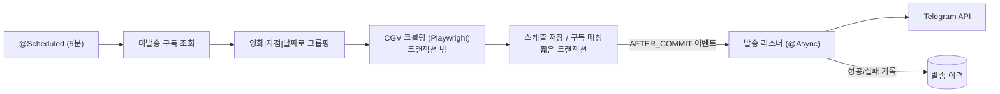

# 🎬 영화 예매 오픈 알리미 (Movie Bot)

CGV 상영 일정을 주기적으로 크롤링해서, 신청한 조건(영화 / 지점 / 상영관 / 날짜)의 **예매가 열리면 텔레그램으로 바로 알려주는 봇**입니다.

## 주요 기능

텔레그램 봇에 명령어를 보내 사용합니다.

| 명령어 | 설명 |
|---|---|
| `/start` | 알림 구독 시작 |
| `/add [영화] [날짜] [지점] [관]` | 알림 신청 (지점, 관은 선택). 예: `/add 위키드 2026-12-24 영등포 IMAX` |
| `/list` | 대기 중인 알림 목록 |
| `/history` | 완료된 알림 목록 |
| `/cancel [번호]` | 알림 취소 |
| `/stop` | 구독 해제 |

## 기술 스택

- **Backend**: Java 17, Spring Boot 4.1, Spring Data JPA, Flyway
- **DB**: MySQL 8.4 (운영), H2 (로컬)
- **Crawling**: Playwright (Chromium)
- **Messaging**: Telegram Bot API
- **Infra**: Docker, Docker Compose

## 동작 흐름



## 주요 개선 사항

### 알림 유실·중복 방지와 트랜잭션 범위 분리

크롤링(외부 I/O)과 발송이 하나의 긴 트랜잭션에 묶여 있던 구조를 통합 테스트로 재현한 뒤 개선했습니다.

| 시나리오 | Before | After |
|---|---|---|
| 크롤링 중 점유 중인 DB 커넥션 | 1개 | **0개** |
| 처리 도중 예외 → 다음 주기 | 같은 알림 2회 발송 | **1회** |
| 매칭 트랜잭션 롤백 | 롤백됐는데 발송됨 | **발송 안 됨** |
| 텔레그램 발송 실패 | SUCCESS 기록, 영구 유실 | **FAIL 기록 후 재시도** |

- Playwright 크롤링을 트랜잭션 밖으로 분리하고 DB 작업만 짧은 트랜잭션으로 처리
- `@TransactionalEventListener(AFTER_COMMIT)`으로 커밋된 경우에만 발송
- 발송 결과(SUCCESS / FAIL)를 기록하고, 실패하면 다음 주기에 재시도

👉 상세 정리 (문제 → 원인 → 해결 → 결과, 트러블슈팅): 노션 링크 추가 예정

## 실행 방법

```bash
cp .env.example .env        # TELEGRAM_BOT_TOKEN 등 입력
docker compose up -d --build
```

로컬 실행 / 테스트:

```bash
./gradlew bootRun           # H2 인메모리 DB
./gradlew test
```
